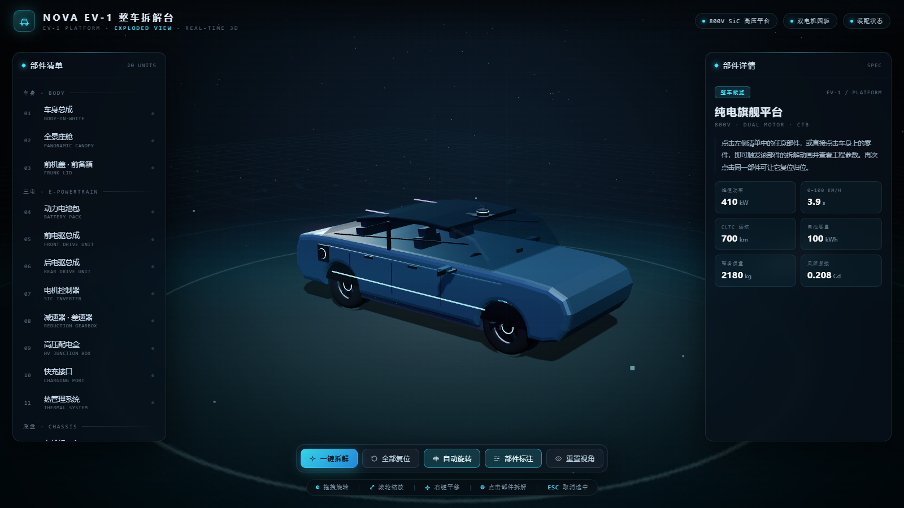
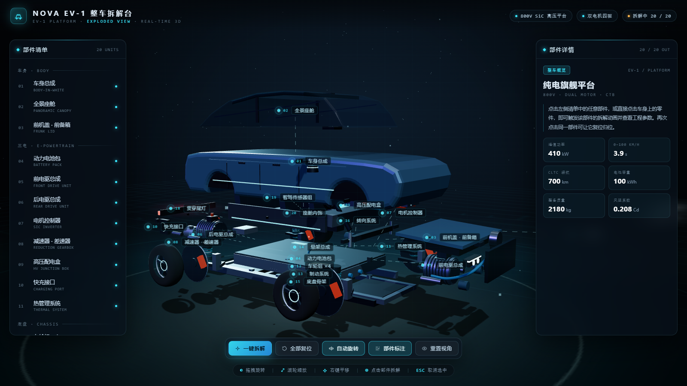
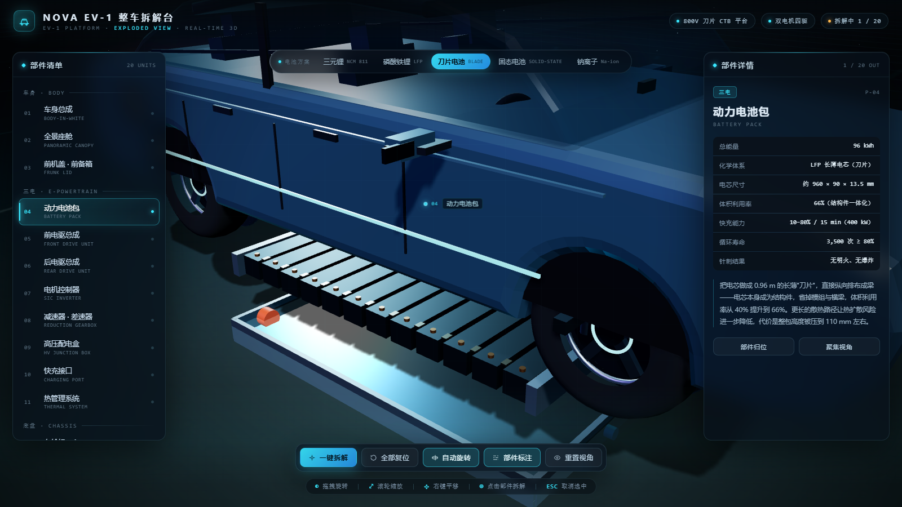

# NOVA EV-1 · 纯电整车拆解可视化

一个**零外部资源**的 Three.js 交互式整车拆解演示：车身、全景座舱、三电、底盘、灯光、智驾等 20 个部件全部由代码实时生成，点击即可拆解并查看工程参数；顶部还能在 **5 种电池化学体系**之间实时切换，电池包几何、参数与整车指标同步重算。





## 快速开始

直接用浏览器（Chrome / Edge / Safari）打开 **`index.html`** 即可，无需服务器、无需联网、无需任何模型文件。

> 页面把 Three.js r160 与全部业务代码内联在同一个 HTML 里（约 1.4 MB），所以双击就能跑，也方便拷给别人。
> 在线版：<https://jefferylegolas.github.io/ev-teardown/>

## 交互

| 操作 | 效果 |
| --- | --- |
| 左键拖拽 | 旋转视角（带阻尼 + 自动旋转） |
| 滚轮 / 双指捏合 | 缩放 |
| 右键拖拽 / Shift + 拖拽 | 平移 |
| 单击部件 | 该部件拆解飞出 + 高亮辉光 + 相机聚焦 + 右侧参数面板 |
| 再次单击同一部件（或再次点清单项） | 归位 |
| 顶部「电池方案」/ `1`–`5` | 切换 三元锂 / 磷酸铁锂 / 刀片 / 固态 / 钠离子 |
| `一键拆解` / `空格` | 全部部件依次拆解并自动取景 |
| `全部复位` / `R` | 全部归位、回到初始视角 |
| `A` / `L` / `V` | 自动旋转 / 部件标注 / 重置视角 |
| `Esc` | 取消选中 |

左侧清单按「车身 / 三电 / 底盘 / 灯光 / 智能」分类，点击任意条目可直接拆解该部件（即使它被车身挡住也能选中）。

## 电池方案切换

| 方案 | 电芯形态 | 能量 | 电压 | 质量能量密度 | 循环寿命 | 整车续航 |
| --- | --- | --- | --- | --- | --- | --- |
| 三元锂 NCM 811 | 8 组方形模组 | 100 kWh | 800 V | 205 Wh/kg | 2,000 次 | 700 km |
| 磷酸铁锂 LFP | 12 组厚模组 + 云母隔热片 | 92 kWh | 800 V | 165 Wh/kg | 4,000 次 | 640 km |
| 刀片电池 BLADE | 12 根 1.42 m 长薄刀片 | 96 kWh | 800 V | — | 3,500 次 | 660 km |
| 固态电池 SOLID-STATE | 6 块薄板 + 固态电解质隔层 | 120 kWh | 1000 V | 400 Wh/kg | 1,500 次 | 900 km |
| 钠离子 Na-ion | 35 颗圆柱电芯密排 | 65 kWh | 700 V | 120 Wh/kg | 5,000 次 | 430 km |

切换时会发生三件事：

1. **几何重建**——托盘高度、电芯数量与形态、汇流排、上盖铭牌全部按方案重新生成（旧网格与材质会 `dispose()`，不会泄漏）；
2. **参数联动**——P-04 的工程参数、充电能力、循环寿命、低温保持随方案更新；
3. **整车指标联动**——右侧概览的功率 / 加速 / 续航 / 容量 / 整备质量与顶部电压平台标签一起重算。

## 效果要点

- **程序化建模**：车身由侧视轮廓沿 Z 轴挤出的曲面（含真实轮拱开口）构成；车轮是旋转体 + 轮辐；电机、热管理、悬架等用圆柱 / 环 / 螺旋弹簧 / 管路曲线组合，全部零贴图。
- **程序化 HDRI**：用 Canvas 画出一张摄影棚环境图，经 `PMREMGenerator` 处理成环境反射，车漆、铝合金才有金属质感（不依赖 HDR 文件）。
- **拆解动画**：每个部件有独立的拆解方向与距离，指数阻尼插值（`1 - e^{-kt}`）；电池包单独用自定义动画（上盖抬起、模组下沉）——切换方案时还能保留当前拆解状态。
- **高亮辉光**：选中时材质自发光向青色偏移 + 加色光晕 Sprite + 虚线引线；标注浮在部件上方并做简单避让。
- **自适应取景**：一键拆解后按整组包围盒自动计算相机距离；单点部件时按包围盒 + 视角方向取景，竖屏启动时自动拉远。
- **响应式**：桌面为左右浮层面板，移动端（≤820px）收成底部抽屉，靠顶部「部件 / 详情」按钮切换，电池方案条自动变成可横滑的一行。

## 目录结构

```
ev-teardown/
├── index.html            # 交付物：单文件、可离线双击
├── build.py              # 把 three.cjs + src/*.js 内联进 index.html
├── vendor/three.cjs      # Three.js r160（CommonJS 构建，内联时包成 IIFE 挂到 window.THREE）
├── src/
│   ├── template.html     # 页面骨架 + 全部 CSS
│   ├── core.js           # 渲染器/灯光/环境贴图/几何工具/自研轨道控制器
│   ├── model.js          # 20 个部件建模 + 五种电池方案
│   └── ui.js             # 拆解动画/高亮/标注/面板/方案切换/主循环
└── preview-*.png
```

重新构建：

```bash
python build.py     # 修改 src/ 后执行，重新生成 index.html
```

## 深链接

| URL | 效果 |
| --- | --- |
| `index.html#exploded` | 直接进入全拆解 |
| `index.html#pick:battery` | 直接聚焦电池包 |
| `index.html?chem=blade` | 打开即为刀片电池 |
| `index.html?chem=solid#exploded` | 固态方案 + 全拆解 |

`chem` 取值：`ncm` / `lfp` / `blade` / `solid` / `sodium`。

## 20 个部件

| # | 部件 | # | 部件 |
| --- | --- | --- | --- |
| 01 | 车身总成 | 11 | 热管理系统 |
| 02 | 全景座舱 | 12 | 车轮组 ×4 |
| 03 | 前机盖 · 前备箱 | 13 | 制动系统 |
| 04 | 动力电池包 | 14 | 悬架总成 |
| 05 | 前电驱总成 | 15 | 底盘骨架 |
| 06 | 后电驱总成 | 16 | 转向系统 |
| 07 | 电机控制器 | 17 | 前灯组 |
| 08 | 减速器 · 差速器 | 18 | 贯穿尾灯 |
| 09 | 高压配电盒 | 19 | 智驾传感器组 |
| 10 | 快充接口 | 20 | 座舱内饰 |

每个部件在 `src/model.js` 中带有 5–7 条工程参数和一段技术说明，可直接改成自己的车型数据。

## 可扩展方向

- 想加第六种方案：在 `src/model.js` 的 `EV.BATTERY_TYPES` 里加一个条目，并在 `buildBatteryCells()` 里补一段几何，UI 会自动多出一个按钮（快捷键顺延）。
- 想换车型：改 `src/model.js` 顶部的 `CAR` 尺寸常量与 `bodyOutline()` 轮廓点，再调各部件坐标即可。
- 想加真实模型：把 `parts[i].group` 里换成 `GLTFLoader` 加载的网格，拆解/高亮/标注逻辑不用改（高亮依赖 `userData.partId`）。
